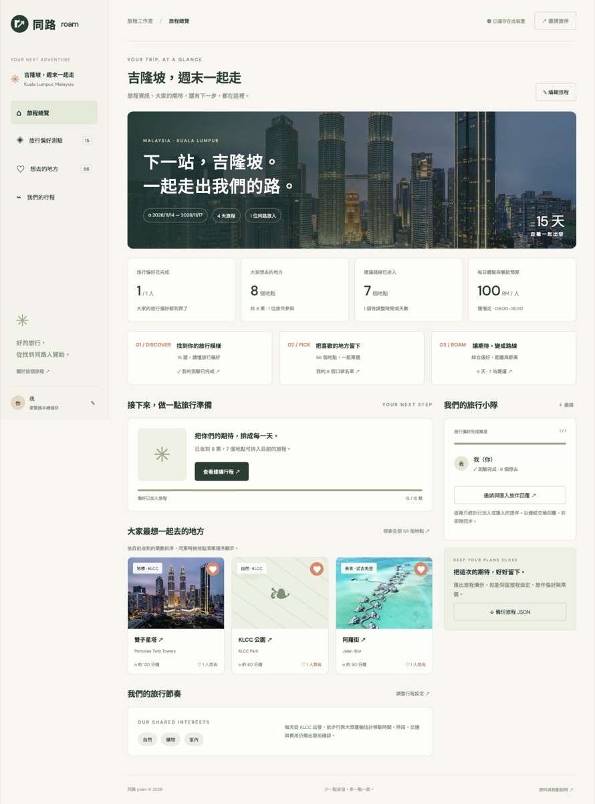

# 同路 Roam · 吉隆坡多人旅行規劃

把每個人的「想去」，排成一起的旅行。

[Live Demo](https://chloe565656.github.io/roam-kl/) · [GitHub](https://github.com/Chloe565656/roam-kl)



## 解決的問題

多人旅行常需要在不同聊天訊息間整理偏好、統計地點票數，再考慮交通與每天的節奏。同路把測驗、票選與路線建議整合成一個可部署至靜態主機的工具。

## 主要功能

- **旅程總覽**：編輯旅程名稱、出發日期與 1–7 天天數；顯示日期範圍、倒數／旅途中／旅行回憶狀態。
- **真實進度**：統計已匯入旅伴的測驗完成數、參與票選人數、總票數、不同地點數與可排入的站數。
- **接續規劃**：依目前使用者的進度，提供測驗、票選或行程入口；顯示熱門票選地點、旅伴狀態及共同偏好。
- **15 題偏好測驗**：前 10 題探索體驗類別，後 5 題設定節奏、出門時間、結束時間、交通與預算。
- **56 個吉隆坡與近郊地點**：支援搜尋、區域／類別篩選、投票與取消票選。
- **可解釋的路線建議**：綜合票數、群體偏好、距離、可用時段、預算與節奏，列出無法排入的地點。
- **靜態多人協作**：透過邀請連結、回覆連結或 JSON 合併旅伴資料；支援旅程備份與還原。
- **響應式介面**：桌機與手機都能編輯旅程、查看統計與管理旅伴。

## 本機啟動

純 HTML、CSS 與 JavaScript，沒有建置步驟，也不需要資料庫或環境變數。

```sh
python3 -m http.server 4173
```

開啟 http://localhost:4173 。請使用 localhost 或 HTTPS，以使用 UUID 與剪貼簿功能。

檢查與測試需要 Node.js，無需安裝第三方套件：

```sh
npm run check
npm test
```

測試涵蓋舊資料升級、日期驗證與時區、旅程編輯及重新載入、票選統計、下一步引導、邀請／備份／回覆合併、儲存失敗，以及 9 組節奏與交通模式的排程限制。

## GitHub Pages 部署

將本專案的檔案放在 repository 根目錄。進入 **Settings → Pages**，選擇 **Deploy from a branch → main → / (root)**。

`index.html`、`style.css`、`places.js`、`app.js` 各自保留為獨立檔案。不要把 HTML 或 CSS 貼進 JavaScript 檔案；`npm run check` 可偵測這類語法錯誤。

## 多人使用流程

1. 在總覽編輯旅程資訊，完成自己的測驗並選出想去的地點。
2. 邀請旅伴；邀請連結包含旅程名稱、日期、設定與當下的資料快照。
3. 旅伴在自己的裝置加入並完成測驗、投票。
4. 旅伴將「我的回覆」連結或 JSON 交給召集人，召集人匯入合併。
5. 在總覽查看群體統計，再到行程頁調整天數、節奏、交通、預算與時段。

這是快照交換，**不是即時同步**。上限 30 位旅伴；同一旅伴 ID 採用時間戳較新的回覆，自己的資料不被外部回覆覆寫。同旅程的回覆只更新旅伴偏好與票選，不覆蓋本機旅程名稱、日期和設定。邀請及還原備份則會帶入旅程資訊。

所有資料保存在本機 `localStorage` 的 `roam-kl-v1`。舊版資料會自動補上預設旅程資訊，保留既有偏好與票選。分享連結內含旅伴名字、偏好和票選，僅分享給同行者；連結太長時改用 JSON。清除瀏覽器資料前請先備份。

## 排程設計

每天由 KLCC 區域作為出發參考點，從有票的地點中逐站選取：

```text
分數 = 票數 × 8
     + 已完成測驗旅伴的類別偏好平均 × 3
     − 直線距離公里 × 1.7
     − 等待分鐘 / 12
```

候選需符合地點可用時段、每日起訖時間與預算。已安排的地點不重複出現。慢／中／快節奏分別最多安排 3／5／7 站，每站額外留 40／25／10 分鐘緩衝。交通依直線距離和所選模式概估。

這是貪婪啟發式建議，不保證全域最短路線。總覽的「可排入站數」使用與行程頁相同的產生器，避免顯示與實際路線不一致的統計。

## 資料與限制

地點名稱參考[馬來西亞觀光局](https://www.malaysia.travel/explore/top-places-to-visit-in-kuala-lumpur)與[吉隆坡旅遊指南](https://ebrochures.malaysia.travel/en/malaysia-travel-guide/kuala-lumpur/)。

- 座標、時段、停留時間、費用與交通皆為排程概略估值，未逐筆核實最新營業狀態。
- 出發日期目前用於日期範圍與倒數；排程尚未處理每週休館日、午休、分段營業、預約或即時路況。
- 預算為每人每日體驗與餐飲估值，不含住宿、交通和購物。
- Google Fonts 與 Unsplash 影像需連網；影像為旅行意象，不代表每個地點的實景。

## 專案結構

```text
index.html                 頁面外殼與導覽
style.css                  響應式版面
places.js                  56 筆規劃資料
app.js                     測驗、票選、總覽、協作與排程
assets/overview.jpg        功能展示畫面
package.json               語法檢查與測試指令
 tests/overview.test.cjs    無第三方依賴的行為測試
```

## 後續方向

- 核實每個地點的官方座標與每週開放時間。
- 增加使用者可設定的住宿／每日出發點。
- 導入共享資料庫，實作跨裝置即時票選與衝突處理。
- 加入導航時間、雨天備案及更完整的路線最佳化。
